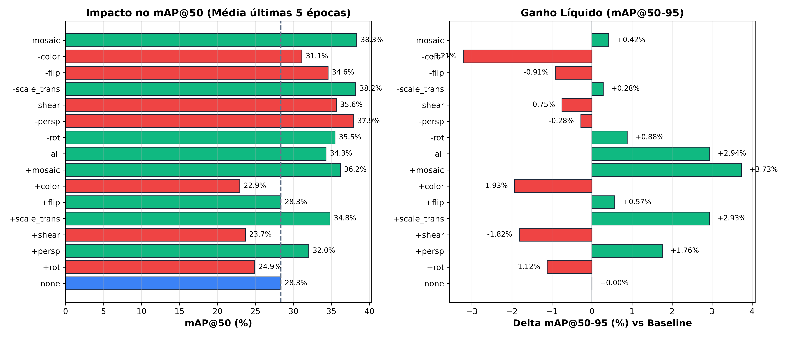
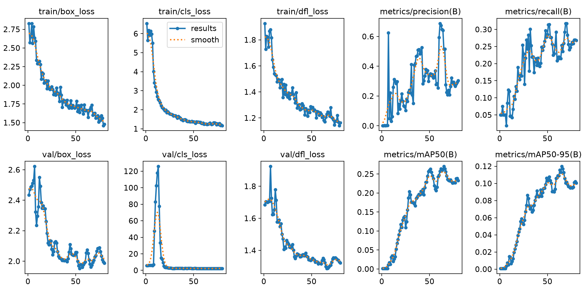
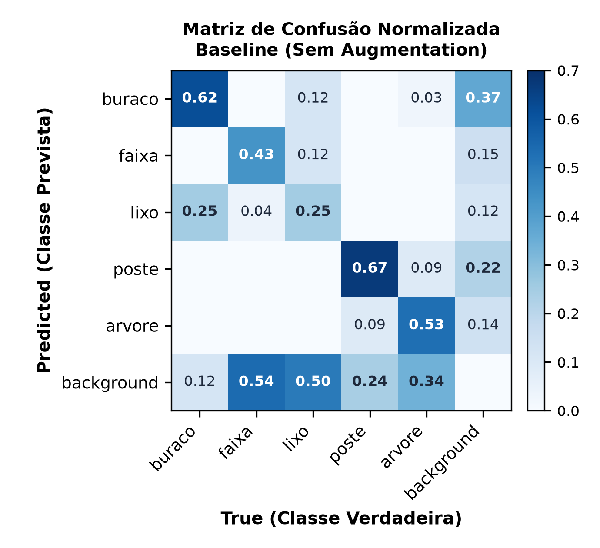
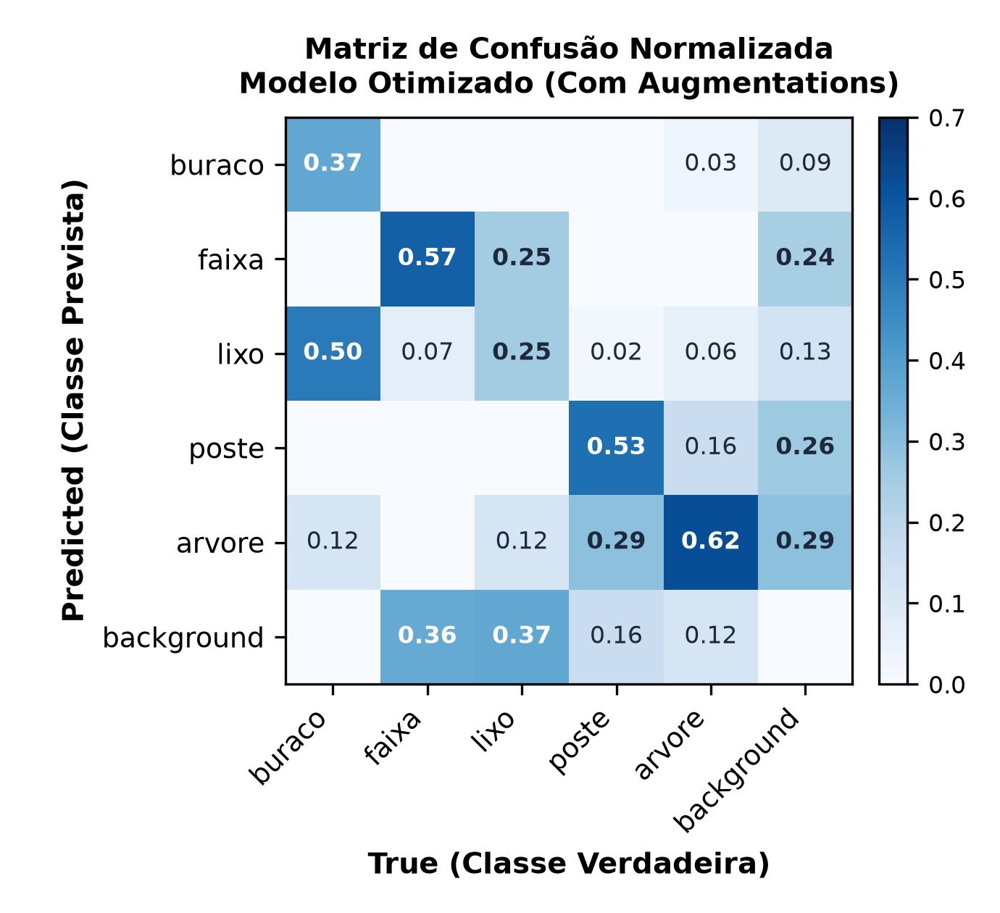
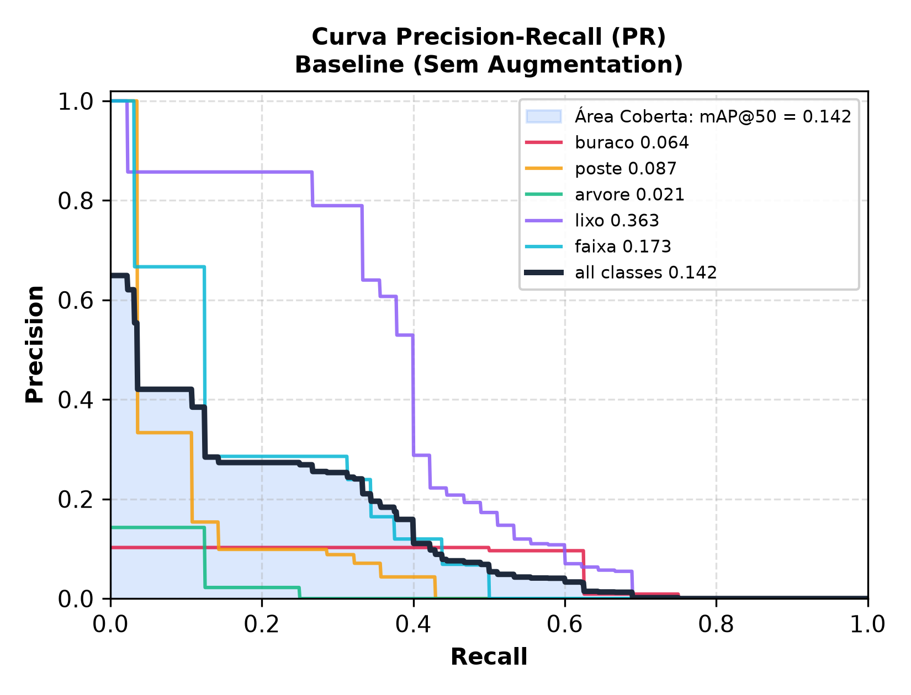
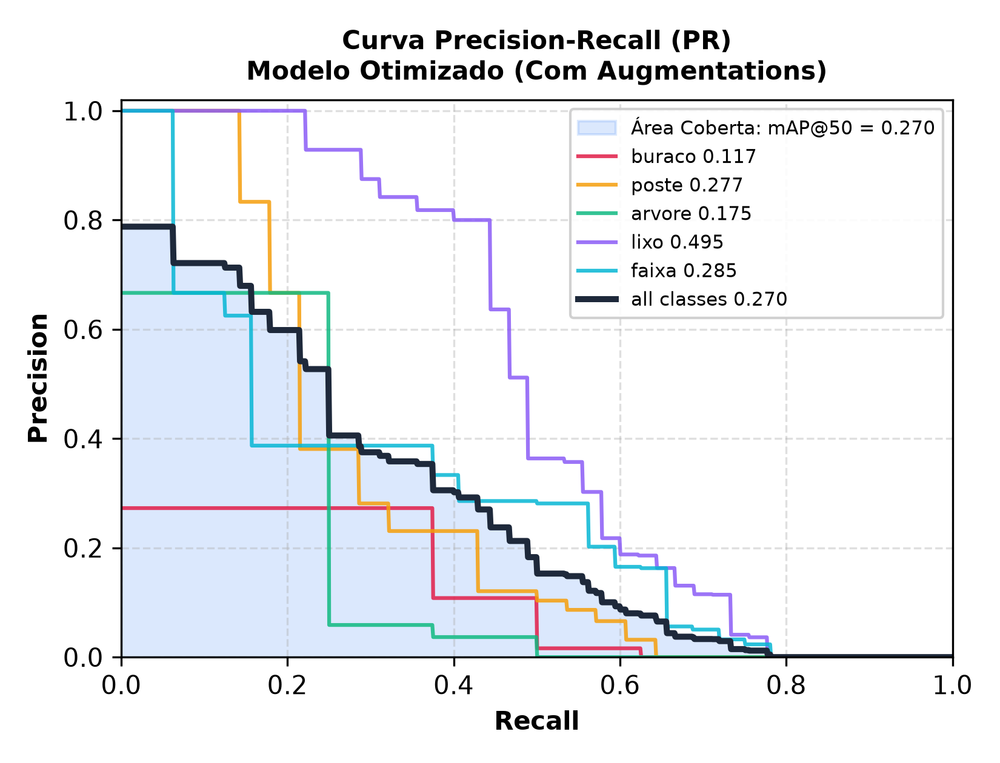
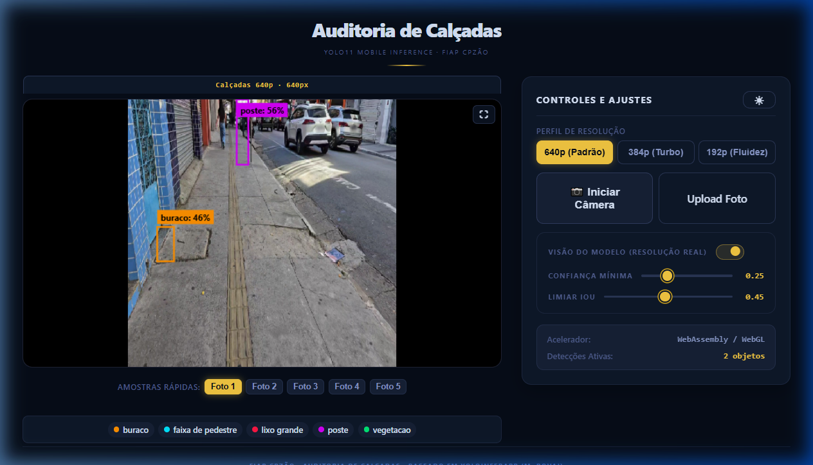
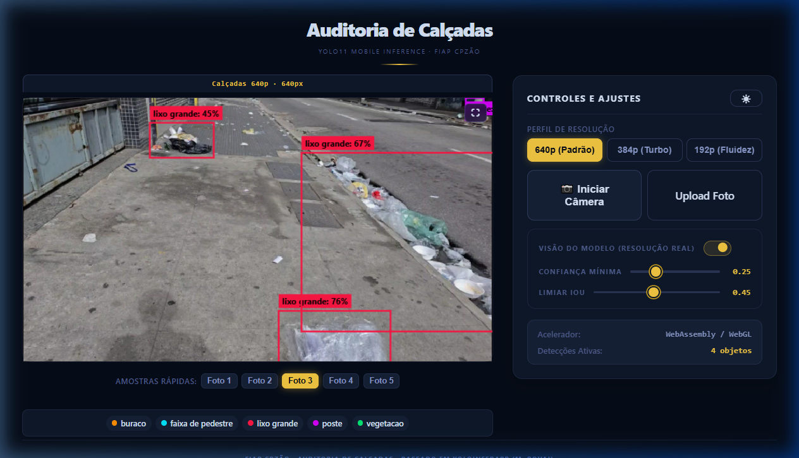

# CPZÃO - Auditoria de Calçadas e Acessibilidade Urbana via YOLO11 Edge

Pipeline de Visão Computacional para detecção de obstáculos e condições de calçadas em tempo real em dispositivos móveis (*edge computing* via câmera traseira do smartphone).

## Integrantes do Grupo

| Nome do Aluno | RM |
| :--- | :--- |
| **Lucas Moreno Matheus** | 97158 |
| **Lorenzo Gomes Andreata** | 551117 |

## Código

Os dois notebooks principais encontram-se na raiz do repositório:

* **[`01_ablation_analysis.ipynb`](./01_ablation_analysis.ipynb)**: **Estudo de Data Augmentation**  
  Análise comparativa detalhada dos 16 experimentos de ablação (configurações isoladas, combinadas e leave-one-out), curvas de desempenho e justificativa das transformações adotadas.
* **[`02_treino.ipynb`](./02_treino.ipynb)**: **Pipeline de Treinamento e Exportação do Modelo**
  Treinamento completo do modelo baseline vs. otimizado (80 épocas), validação no split de teste, curvas de convergência, matriz de confusão normalizada e exportação das variantes ONNX (640p, 384p e 192p).

## Objetivo e Escopo

Auditar a infraestrutura de calçadas urbanas identificando elementos críticos para acessibilidade e segurança de pedestres diretamente na câmera do celular, sem envio de fluxo de vídeo para servidores externos.

### Classes Mapeadas (5 classes)

1. `buraco`: Falhas estruturais no piso, lajotas soltas e bueiros sem grelha.
2. `poste`: Postes de iluminação pública, hastes metálicas e pilares obstrutivos.
3. `arvore`: Troncos de árvores e raízes que invadem a faixa livre de circulação.
4. `lixo`: Sacos de resíduos, entulho ou caixas descartadas sobre a calçada.
5. `faixa`: Faixas de pedestres e demarcações viárias de travessia.

## Dataset e Curadoria

Amostras fotográficas derivadas do projeto de Auditoria de Calçadas (com base de imagens abertas do Mapillary) em percursos urbanos, organizadas com divisão temporal entre os conjuntos para evitar vazamento de dados (*data leakage* de quadros sequenciais correlacionados).

| Split | Imagens | Buraco | Poste | Árvore | Lixo | Faixa | Total de Bounding Boxes |
| :--- | :---: | :---: | :---: | :---: | :---: | :---: | :---: |
| **Treino (`train`)** | 64 | 17 | 185 | 48 | 168 | 116 | 554 |
| **Validação (`val`)** | 19 | 8 | 28 | 8 | 45 | 32 | 121 |
| **Teste (`test`)** | 12 | 3 | 14 | 13 | 30 | 24 | 84 |
| **Total** | **95** | **28** | **227** | **69** | **243** | **172** | **739** |

*Formato das anotações:* YOLO Darknet (`class_id x_center y_center width height` normalizados).

## Estudo de Data Augmentation (Ablação)

Para mitigar overfitting decorrente do tamanho limitado do dataset (95 imagens), realizou-se um estudo sistemático de ablação de transformações geométricas e fotométricas (60 épocas por experimento) avaliando o impacto relativo no mAP:



### Resultados da Ablação

| Configuração | mAP@50 (Média últimas 5 épocas) | mAP@50-95 (Média últimas 5 épocas) | $\Delta$ vs Baseline | Status na Pipeline Final |
| :--- | :---: | :---: | :---: | :--- |
| **Baseline (`none`)** | **28.35%** | **10.46%** | - | Referência sem transformações |
| `+mosaic` | **36.16%** | **14.19%** | **+3.73%** | **Adotado** (combina 4 imagens em escala reduzida) |
| `+scale_trans` | **34.81%** | **13.39%** | **+2.93%** | **Adotado** (variação de aproximação e translação) |
| `+persp` | **32.03%** | **12.22%** | **+1.76%** | **Adotado** (simula perspectiva de ângulo de visão) |
| `+flip` (horizontal) | 28.35% | 11.03% | +0.57% | **Adotado** (inversão lateral esquerda/direita) |
| `+rot` ($\pm 10^\circ$) | 24.90% | 9.35% | -1.12% | **Adotado** (justificativa operacional de campo) |
| `+shear` | 23.66% | 8.64% | -1.82% | **Descartado** (deformação excessiva da geometria) |
| `+color` (jitter forte) | 22.94% | 8.53% | -1.93% | **Descartado** (prejudica distinção piso vs defeito) |

> **Justificativa Operacional da Rotação (`+rot`):**  
> No dataset estático, os postes aparecem em orientação rigorosamente vertical, gerando penalização numérica quando rotacionados no treino. Em campo, contudo, o operador segura o smartphone com as mãos em caminhada. A rotação garante robustez contra inclinações naturais do aparelho.

## Treinamento e Avaliação do Modelo

* **Backbone:** YOLO11 Nano (`yolo11n.pt` pré-treinado no COCO).
* **Treinamento Principal:** 80 épocas, otimizador com cosine learning rate scheduler.
* **Tamanho de Entrada:** 640x640 pixels.

### Comparativo: Baseline vs Modelo com Augmentations Selecionadas

| Métrica | Baseline (Sem Augmentation) | Modelo Otimizado Final | Delta Relativo |
| :--- | :---: | :---: | :---: |
| **Precision** | 29.30% | **28.37%** | -3.2% |
| **Recall** | 11.55% | **26.55%** | **+129.9%** |
| **mAP@50** | 14.17% | **23.26%** | **+64.2%** |
| **mAP@50-95** | 6.16% | **9.89%** | **+60.5%** |

### Curvas de Treinamento e Validação



### Matrizes de Confusão Normalizadas (Baseline vs Otimizado)

| Baseline (Sem Augmentation) | Modelo Otimizado (Com Augmentations) |
| :---: | :---: |
|  |  |

### Curvas Precision-Recall (Baseline vs Otimizado)

| Baseline (Sem Augmentation) | Modelo Otimizado (Com Augmentations) |
| :---: | :---: |
|  |  |

> A área sombreada sob a curva *all classes* representa geometricamente o **mAP@50 (AUC-PR)**: a expansão da área no modelo otimizado comprova visualmente a retenção de precisão em faixas superiores de recall.

### Análise Crítica das Matrizes e Trade-off de Detecção

A interpretação conjunta das matrizes e curvas PR elucida o trade-off de sensibilidade (*Recall*) alcançado:

* **Redução Significativa de Omissões (Falsos Negativos):**  
  Na linha `background` (objetos reais que o detector não encontrou), o baseline apresentava omissões graves: deixava de detectar **54% das faixas**, **50% do lixo**, **34% das árvores** e **24% dos postes**. No modelo otimizado, as omissões de postes caíram para **16%** e de árvores para **12%**, impulsionando o salto de recall global de **11.55% para 26.55%**.

* **Dinâmica da Classe `poste` (0.67 ➔ 0.53 na diagonal):**  
  O percentual de 0.67 do baseline era fruto de um viés ultraconservador: o modelo só emitia predições para postes isolados e óbvios de primeiro plano (seu mAP@50 isolado era de apenas **0.087**). Ao incorporar data augmentations - sobretudo a **rotação** para tolerar inclinações do celular em caminhada -, o detector passou a encontrar postes distantes e hastes delgadas, elevando o mAP@50 de postes para **0.277** (+218%). Esse ganho agressivo de sensibilidade gera uma sobreposição morfológica limítrofe com troncos de árvores (a confusão entre poste e árvore variou de 0.09 para 0.16), um compromisso clássico de engenharia preferível à omissão total de obstáculos na via pública.

## Deploy Mobile Edge (ONNX Runtime Web)

O modelo treinado foi exportado para o formato ONNX e integrado a uma aplicação web otimizada para smartphones baseada no `yoloinferApp`.

* **Processamento Local:** Inferência executada diretamente no navegador via WebAssembly e WebGL (ONNX Runtime Web).
* **Câmera Traseira:** Captura de vídeo com restrição de ambiente (`facingMode: environment`) e foco contínuo.
* **Perfis de Resolução:**
  * **640p (Padrão):** Resolução nativa de treino para precisão máxima.
  * **384p (Turbo):** Perfil intermediário balanceando taxa de quadros e latência.
  * **192p (Fluidez):** Perfil leve voltado a dispositivos móveis com hardware restrito.
* **Interface Responsiva & Tela Cheia:** Layout adaptativo com monitor de auditoria centralizado e painel lateral de controles no desktop, layout vertical compacto para celulares e modo tela cheia nativo (`⛶`).
* **Modo "Visão do Modelo":** Inspeção da resolução efetiva alimentada à rede, mantendo proporção de tela corrigida.

### Demonstração no Aplicativo

| Detecção de Buraco e Poste | Detecção de Sacos de Lixo |
| :---: | :---: |
|  |  |

## Estrutura do Repositório

```text
├── .github/                   # CI/CD automatizado
│   └── workflows/deploy.yml   # Build e deploy contínuo no GitHub Pages
├── app/                       # Aplicação Mobile Edge (derivada do yoloinferApp)
│   ├── Code/                  # Frontend Vite + ONNX Runtime Web
│   │   ├── public/models/     # Modelos ONNX servidos ao app
│   │   ├── public/samples/    # Amostras para teste offline
│   │   └── src/               # Pipeline de inferência e interface
│   ├── LICENSE                # Licença MIT do autor original (M. Rovai)
│   └── README.md              # Referência direta ao repositório yoloinferApp
├── dataset/                   # Dataset unificado e validado (95 imagens, train/val/test)
│   ├── images/                # Imagens JPEG por split
│   ├── labels/                # Anotações formato YOLO Darknet
│   └── data.yaml              # Configuração de caminhos e nomes de classes
├── models/                    # Modelos finais exportados
│   ├── sidewalk-yolo11n.pt    # Pesos PyTorch treinados (5.2 MB)
│   ├── sidewalk-yolo11n-640.onnx
│   ├── sidewalk-yolo11n-384.onnx
│   └── sidewalk-yolo11n-192.onnx
├── reports/                   # Relatórios e figuras geradas
│   ├── ablation.csv           # Dados consolidados dos 16 experimentos de ablação
│   └── figures/               # Curvas de treino, matriz de confusão e capturas do app
├── 01_ablation_analysis.ipynb # Caderno 1: Pipeline completo e análise do estudo de ablação
├── 02_treino.ipynb            # Caderno 2: Pipeline de treino (80 épocas), validação e exportação ONNX
├── pyproject.toml             # Gerenciamento de ambiente Python via uv
└── README.md
```

## Guia de Execução e Deploy

### 1. Ambiente Python e Cadernos de Análise (com `uv`)

Para sincronizar o ambiente virtual e inspecionar os cadernos executáveis na raiz:

```bash
# Sincronização de dependências (PyTorch CUDA, Ultralytics, ONNX Runtime)
uv sync

# Inicialização do Jupyter Lab para inspeção dos cadernos 01 e 02
uv run jupyter lab
```

### 2. Execução Local do Aplicativo Mobile Edge

Para inicializar a interface web localmente e permitir conexão de smartphones na mesma rede:

```bash
# Acessar o diretório da aplicação
cd app/Code

# Instalação de dependências do frontend
npm install

# Inicialização do servidor local com suporte a host de rede
npm run dev -- --host
```

* **Acesso em Dispositivo Móvel:** Abrir o endereço de rede informado no terminal (ex.: `https://192.168.X.X:5173`) no navegador do smartphone conectado ao mesmo Wi-Fi.
* **Validação:** Acionar **"Iniciar Câmera"** para inferência em tempo real via câmera traseira ou utilizar **"Amostras Rápidas"** para verificação estática de classes.

### 3. Deploy Contínuo no GitHub Pages

O projeto inclui automação de CI/CD via GitHub Actions em [`.github/workflows/deploy.yml`](.github/workflows/deploy.yml):

1. Na seção **Settings** ➔ **Pages** do repositório, selecionar a opção **Source: GitHub Actions**.
2. A cada *push* na branch `main`, o workflow compila o frontend e publica o artefato estático sob conexão **HTTPS nativa** (requisito de segurança dos navegadores para liberar o fluxo de câmera).

## Referências e Créditos

* **Material da Disciplina:** [Computer Vision - Prof. Arnaldo Jr.](https://arnaldojr.github.io/computervision/) - conteúdo programático, materiais de aula e referências de Visão Computacional (FIAP).
* **Metodologia de Referência e Base de Dados:** [Auditoria de Calçadas - Projeto e Metodologia](https://falzoni.com.br/auditoriacalcadas/) - fundamentação técnica para coleta e caracterização de condições de caminhabilidade a partir de imagens públicas do [Mapillary](https://www.mapillary.com/).
* **Base da Aplicação Mobile:** [yoloinferApp (Mjrovai)](https://github.com/Mjrovai/yoloinferApp) - aplicação desenvolvida por Marcelo Rovai para inferência de modelos YOLO no navegador, adaptada neste projeto para detecção de obstáculos e acessibilidade urbana.
* **Arquitetura YOLO:** [Ultralytics YOLO11](https://github.com/ultralytics/ultralytics).
